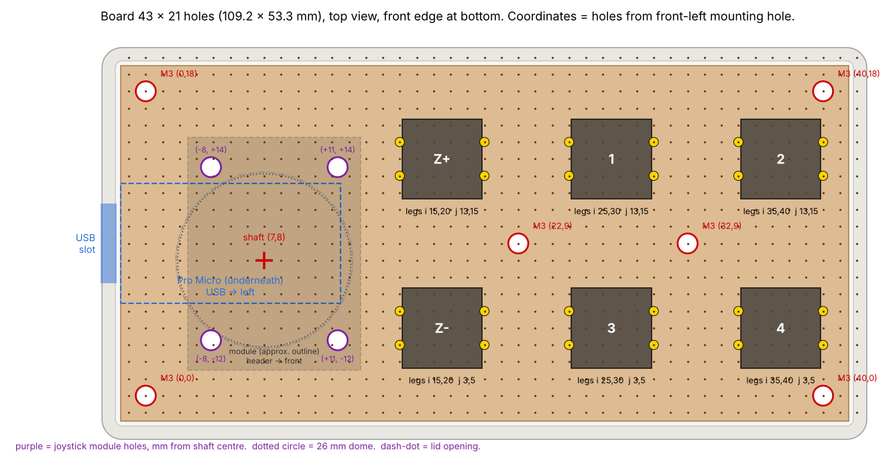
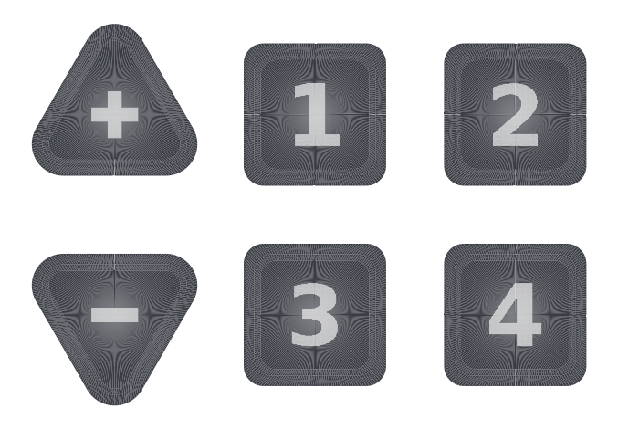
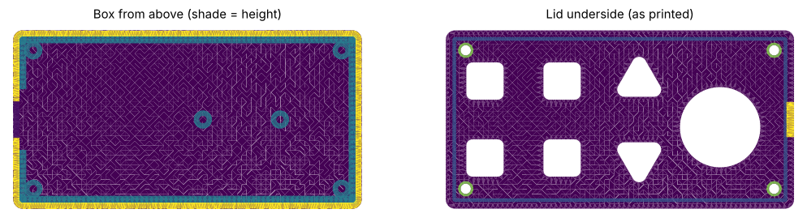

# PTZ Controller

A small desk controller for a PTZ camera. It is built from an Arduino Pro Micro, a thumb joystick and six tactile buttons. Windows sees it as an ordinary USB game controller, and a key mapper such as JoyToKey turns its stick and buttons into the camera's keyboard shortcuts. It was built to control a Verkada PTZ camera.



## Controls

| Control | Windows input | Typical mapping |
|---|---|---|
| Joystick | X / Y axes | Pan / tilt |
| ▲ Zoom + | Button 1 | Zoom in (hold) |
| ▼ Zoom − | Button 2 | Zoom out (hold) |
| 1–4 | Buttons 3–6 | Presets or anything else |
| Stick click | Button 7 | Spare |

In the key mapper, set the zoom buttons to hold their key down rather than tap it, so the camera keeps zooming while the button is held.

## Repository layout

```
firmware/PTZController/PTZController.ino   Arduino sketch
hardware/enclosure.py                       Generates box, lid, board layout and drilling template
hardware/keycaps.py                         Generates the keycaps
hardware/box.stl, lid.stl                   Enclosure, ready to print
hardware/keycaps_body.stl, keycaps_labels.stl   Keycaps (two-colour, load together)
hardware/board_layout.png                   Placement drawing in perfboard hole coordinates
hardware/drill_template.pdf                 1:1 drilling template (A4)
hardware/*_preview.png                      Previews
```

## Parts

- Arduino Pro Micro (ATmega32U4). A Leonardo or Micro also works; an Uno or Nano will not, because they lack native USB.
- KY-023 style thumb joystick module
- 6 × 12 × 12 mm tactile switches with round actuators
- Perfboard (2.54 mm pitch), cut to 43 × 21 holes (109.2 × 53.3 mm)
- Screws:
  - 4 × M3×25 pan or button head, for the lid corners (through lid, board and into the standoffs)
  - 2 × M3×8, for the board at the two middle standoffs
  - 4 × M3×10 or M3×12 plus 8 nuts, for the joystick module (one nut is a spacer under the module)
- Hookup wire, plus tinned copper wire for a ground bus

## Firmware

1. In the Arduino IDE, install **ArduinoJoystickLibrary** by MHeironimus ([GitHub](https://github.com/MHeironimus/ArduinoJoystickLibrary)).
2. Open `firmware/PTZController/PTZController.ino`, select the Pro Micro / Leonardo board and upload.
3. Check it under Windows **Set up USB game controllers**.

### Wiring

All buttons switch to GND and use the internal pull-ups, so no resistors are needed. Wire each tactile switch across diagonal legs.

| Pro Micro pin | Connects to |
|---|---|
| VCC / GND | Joystick +5V / GND |
| A0 / A1 | Joystick VRx / VRy |
| 8 | Joystick SW |
| 2 / 3 | Zoom + / Zoom − |
| 4 / 5 / 6 / 7 | Buttons 1 / 2 / 3 / 4 |

If an axis turns out reversed once everything is in the box, set `INVERT_X` or `INVERT_Y` in the sketch.

## Building the board

Coordinates are counted in holes from the front-left mounting hole, with the front edge at the bottom of `board_layout.png`.

- **Mounting holes:** drill out to 3 mm at (0,0), (40,0), (0,18), (40,18), plus the middle standoffs at (22,9) and (32,9).
- **Joystick:** shaft centre over hole (7,8), header facing the front. Its mounting holes are off the grid, so print `drill_template.pdf` at 100% / actual size, check the 50 mm scale bar, lay the module on it to confirm, then mark and drill. From the shaft centre the holes are at (−8, +14), (+11, +14), (−8, −12) and (+11, −12) mm.
- **Switches:** each switch is centred on a hole row and halfway between two columns. The legs for each switch are listed on the drawing (for example Z−: columns 15 and 20, rows 3 and 5).
- **Pro Micro:** underneath the board, USB connector flush with the left edge, lined up with the slot in the box.
- **Edge ledge:** the box has a 1.5 mm ledge round the inside that the board rests on, so keep the outermost row of holes free of solder joints. The ledge has a gap on the left for the Pro Micro.

## Printing

Both scripts need only Python 3 with numpy, Pillow and matplotlib. Edit the parameters at the top and run them from the `hardware` folder; they write their outputs next to themselves.

```
cd hardware
python3 keycaps.py
python3 enclosure.py
```

### Keycaps

- Two round-cornered triangles for zoom (pointing up and down, with + and −) and four square caps labelled 1–4.
- Import `keycaps_body.stl` and `keycaps_labels.stl` together. When the slicer asks whether to load them as one object with multiple parts, say yes, then give the labels a second filament colour.
- Print upright with no supports.
- The socket is tapered to fit an actuator 6.0 mm at the tip, 6.8 mm at the base and 8.8 mm long. Print one cap first to check the fit, then adjust `FIT_CLEAR` in `keycaps.py` (−0.1 for tighter, +0.05 for looser).
- The 13.5 mm flange at the base sits under the lid and keeps the caps captive.

### Box and lid

- Box: 114.7 × 58.8 × 26.1 mm, 2 mm walls, four corner standoffs, two middle standoffs and an edge ledge. The USB cable exits through a slot in the left wall that is open at the top, so the cable lifts out when the lid is off.
- Lid: push-fit locating lip, holes for the keycaps (0.4 mm clearance) and a 26.5 mm round hole for the joystick. A tab closes over the USB slot, and four corner posts trap the board.
- `lid.stl` is already flipped top-face-down. Both parts print with no supports.
- The lid height assumes the switch stem tips sit **12 mm above the perfboard** (`STEM_TOP` in `enclosure.py`), which leaves the caps about 2.5 mm proud of the lid. Measure your build and adjust before printing the lid if it differs.
- The standoffs have 2.5 mm pilot holes, so the M3 screws cut their own thread. Don't overtighten the lid screws.

## Previews




